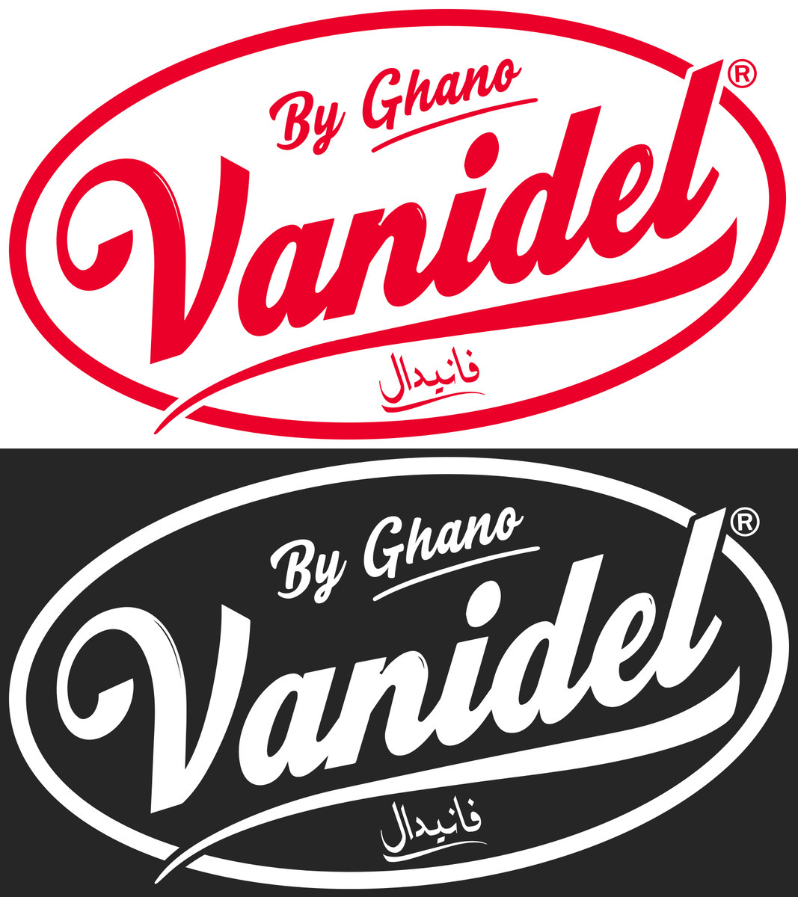

# Vanidel brand on the platform

How the client's charter (`charte graphique vanidel 2026.pdf`, October 2026) is applied to the site and the admin. The charter itself and the original logo PDF are kept with the project files, not in git.

## The charter in short

| Item         | Charter                       | On the web                                                                                                   |
| ------------ | ----------------------------- | ------------------------------------------------------------------------------------------------------------ |
| Red          | `#EA0029` · Pantone 185 C     | Primary colour, exactly `#EA0029`. White on it is 4.64:1 (AA).                                               |
| Blue         | `#308AB9` · Pantone 7688 C    | Second brand colour. White on it is 3.85:1, so white text on it is large text only (24 px, or 18.7 px bold). |
| Cream        | `#F2DAB2` · Pantone 7506 C    | Background bands. Dark text on it is 12:1.                                                                   |
| Title font   | Futura LT Paneuropean Bold    | Free look-alike until web licences are bought.                                                               |
| Body font    | Franklin Gothic Book ("Core") | Free look-alike until web licences are bought.                                                               |
| Slogan       | كلشي يسهال, Arabic only       | Vector artwork, shown untranslated in every locale. Never typed as text.                                     |
| Text colour  | Not specified                 | Ink `#231F20`, the black of the logo file.                                                                   |
| Arabic fonts | Not specified                 | Chosen to match the character and weight of the Latin fonts.                                                 |

Hex values are used on screen; the Pantone references are for print only.

## Files

Files fetched by a fixed URL (favicons, the default share image) live in `public/`. Files used inside components live in `src/assets/brand/` and are imported statically, so `next/image` gets their size and serves them from `/_next/static/media` with a hashed name.

| File                                                    | What it is                                           | Use it on                                                    |
| ------------------------------------------------------- | ---------------------------------------------------- | ------------------------------------------------------------ |
| `src/assets/brand/logo/vanidel-logo-red.svg`            | Full logo, flat, charter red                         | White or cream backgrounds only                              |
| `src/assets/brand/logo/vanidel-logo-white.svg`          | Full logo, white                                     | Red or blue backgrounds, dark mode                           |
| `src/assets/brand/logo/vanidel-mark-red.svg`            | The "V" mark alone, red                              | Where the full logo would be under 72 px wide                |
| `src/assets/brand/logo/vanidel-mark-white.svg`          | The "V" mark alone, white                            | Same, on red or blue                                         |
| `src/assets/brand/logo/vanidel-mark-red-square.svg`     | The red mark centred in a transparent square         | Square slots such as the admin's navigation icon             |
| `src/assets/brand/slogan/kolchi-yeshal-white.svg`       | The slogan, white, traced from the charter           | Red or blue backgrounds                                      |
| `src/assets/brand/slogan/kolchi-yeshal-red.svg`         | The slogan, red                                      | White or cream backgrounds                                   |
| `src/assets/brand/packshots/vanidel-packshots-mix.png`  | Crêpes, pancake, brownies and gaufres boxes, cut out | Red bands, the default share image                           |
| `src/assets/brand/packshots/vanidel-packshots-flan.png` | The five flan sachets, cut out                       | Blue bands, as in the charter                                |
| `src/assets/brand/photos/vanidel-chef-ambassador.png`   | The chef ambassador, cut out, 2000 px wide           | Approved for the "no contest running" state only (see below) |
| `public/brand/icons/favicon.svg`                        | White mark on a rounded red square                   | Browser tab icon, site and admin                             |
| `public/favicon.ico`                                    | 16, 32 and 48 px, made from `favicon.svg`            | Browsers that ask for `/favicon.ico`                         |
| `public/brand/icons/apple-touch-icon.png`               | 180 px, opaque, made from `favicon.svg`              | Home-screen icon on iOS                                      |
| `public/brand/share/vanidel-share-default.png`          | 1200×630: logo, slogan and packshots on red          | Share previews of pages without their own image              |

The three files marked "made from" are generated by `pnpm brand:assets` (`src/lib/scripts/brand-assets.mjs`). Run it after changing `favicon.svg`, the white logo, the white slogan or the Mix packshot, and commit what it writes. Builds never run it.

The full-resolution chef photo (3300 px) is kept with the project files under `brand/source/`.

## Rules

- **Backgrounds.** The red logo goes on white or cream, the white logo on red or blue. Never put the logo directly on a photo.
- **Clear space.** Keep at least 25% of the logo's height free on every side.
- **Minimum size.** The full logo is never narrower than 72 px; below that, use the mark alone.
- **Slogan.** Always the vector artwork, in white on red or blue, or in red on white or cream. It is the same in French and Arabic, and its `alt` text is marked `lang="ar"`. If a French slogan is supplied one day, it replaces these two files and nothing else changes.
- **Mirroring.** Logos, the slogan, packshots and photos are never mirrored in Arabic (right-to-left). Where a picture has a direction, it is placed physically, not logically.
- **Chef photo.** Used only in the "no contest running" empty state, on the right in both languages: his gesture points left, at the message, and mirroring the photo would reverse the logo on his apron.
- **Packshots.** The Mix boxes go with red, the flan sachets with blue, as in the charter.
