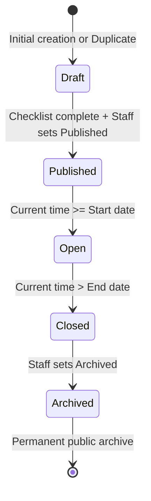

# 5.4 Admin Operations: Previewing, Publishing & Lifecycle

Campaigns transition through a structured lifecycle from initial draft to permanent archive.

---

## 5.4.1 Staff Preview Mode

Before making a campaign live to the public, commercial staff can preview the exact consumer experience:

1. In the contest editor, locate the **Aperçu** (_Preview_) button (square icon with an arrow next to _Sauvegarder_):

_Figure 5.12: The Aperçu button in the contest header._

2. Clicking **Aperçu** opens the contest in preview mode (`/api/preview?contest=...&locale=fr`):

_Figure 5.13: Staff preview mode displaying the yellow notice banner._

### Characteristics of Preview Mode

- Displays a prominent status banner: _"Aperçu. Ce concours est un brouillon : seule l’équipe le voit, tel qu’il apparaîtra une fois publié. Les participations y sont refusées."_
- Lets staff verify hero imagery, typographic flow, prizes, and form layout.
- Prevents accidental form submissions.
- Clicking **Quitter l’aperçu** terminates the preview session.

---

## 5.4.2 Publishing a Contest

To launch the campaign:

1. Verify that all mandatory items in the **Avant de publier** checklist show a green checkmark (✓).
2. In the right sidebar, verify the **Identifiant URL** (_Slug_):
   - Keep it concise, meaningful, and lowercase (e.g. `gamme-mix-2026`).
   - **Crucial Rule**: Once packaging QR codes or print banners have been printed, **never change the slug**.
3. Set the **Premier jour** (_Start date_) and **Dernier jour** (_End date_):
   - Opens at 00:00 (midnight Algiers time) on the start date.
   - Closes at 23:59:59 (Algiers time) on the end date.
4. Set **Statut** to **Publié** (_Published_).
5. Click **Sauvegarder** (_Save_).

> [!NOTE]
> If a contest is published before its start date, it appears on the public site with the status badge **À venir** (_Coming soon_) and displays _"Ouverture le DD/MM/YYYY"_. Participation forms open automatically when the start date arrives.

---

## 5.4.3 The Contest Lifecycle States

1. **Brouillon (Draft)**: Invisible to the public; accessible only by authenticated staff via Preview mode.
2. **Publié (Published)**: Publicly listed. If before start date, shows _"À venir"_. If within dates, actively accepts participations.
3. **Fermé (Closed)**: Automatically stops accepting entries once end date passes. Displays _"Ce concours est terminé"_.
4. **Archivé (Archived)**: Concluded contest moved to the permanent past contests archive (`/concours/archives`). All published winners remain permanently viewable.
