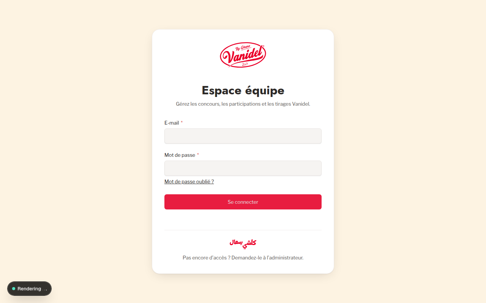

# 2. Getting Started

This section outlines how to access the Vanidel platform, authenticate staff members, configure regional language preferences, and understand interface basics.

---

## 2.1 Accessing the Application

The Vanidel platform is organized into two primary entry points:

- **Public Experience**: Accessible at the root URL (e.g., `https://vanidel.com` or local development at `http://localhost:3000`).
  - French Portal: `http://localhost:3000/fr/concours`
  - Arabic Portal: `http://localhost:3000/ar/concours`
- **Administration Suite**: Accessible at `/admin` (e.g., `http://localhost:3000/admin`).

> [!NOTE]
> Public participants never need an account or password to participate in contests. Authentication is reserved exclusively for Vanidel commercial staff and technical administrators.

---

## 2.2 Staff Authentication

### Step-by-Step Login

1. Open your browser and navigate to `/admin` or `/admin/login`.
2. The branded Vanidel login screen appears, featuring the brand identity and the motto _"كلشي يسهال"_.

_Figure 2.1: The Vanidel Administration login portal._

3. Enter your assigned organizational email address (e.g. `commercial@vanidel.local` or `admin@vanidel.local`).
4. Enter your secure password.
5. Click **Se connecter** (_Sign in_).
6. Upon successful authentication, you will be redirected to the **Tableau de bord** (_Dashboard_).

### Password Recovery

If you have forgotten your password:

- Click the **Mot de passe oublié ?** link on the login page (`/admin/forgot`).
- Enter your registered email address.
- If an email adapter is configured in production, a secure reset token is sent to your inbox. In local development environments without an active SMTP gateway, password resets must be provisioned by a system administrator.

---

## 2.3 Regional & Language Configuration

The back-office interface can be operated in **Français** (_French_), **العربية** (_Arabic_), or **English**.

1. In the top navigation bar, locate the **Paramètres régionaux** (_Locale_) dropdown button.
2. Select your preferred administrative working language.
3. The interface labels, tooltips, and system notifications instantly adapt to the selected language.

> [!TIP]
> Changing your administrative interface language affects only your personal view of the admin controls. It does **not** alter the public French or Arabic contest content submitted to consumers.

---

## 2.4 Interface Theme and Personal Account

Staff members can manage their account profile and display settings:

1. Click on the **Compte** (_Account_) avatar located at the top right of the navigation header (`/admin/account`).
2. You can update your display name, email address, or update your password.
3. You can configure your visual theme preference (Light, Dark, or System default).
4. Click **Sauvegarder** to persist your preferences.
