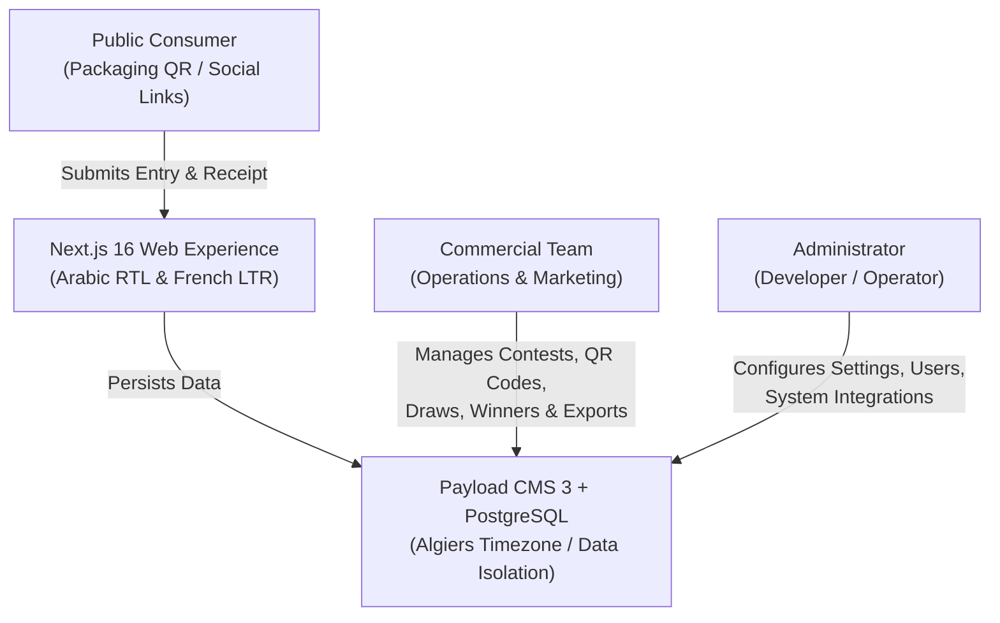

# 1. Introduction

## 1.1 Application Overview

**Vanidel** is an enterprise-grade, reusable contest and tombola platform designed for **SARL Vanidel**, an Algerian agri-food manufacturing company renowned for its culinary preparations (_Gamme Mix_, _Gamme Crème_, _Gamme Flan_).

Unlike disposable, one-off campaign landing pages, Vanidel is an extensible platform engineered to support recurring consumer campaigns across Algeria. It provides an intuitive, bilingual public-facing participation portal (French and Arabic) and a back-office administration suite tailored for Vanidel's commercial team.

---

## 1.2 Core Business Capabilities

The platform delivers the following capabilities:

1. **Repeated Campaign Management**: Vanidel's commercial team can launch, configure, schedule, and close future contests autonomously through the administrative dashboard without needing developers or code modifications.
2. **Frictionless Consumer Entry**: Participants can enter campaigns in under two minutes via mobile or desktop without creating an account or memorizing credentials.
3. **Algérie-Centric Data Capture**: Native support for Algerian mobile phone standards (`05`, `06`, `07`), all 58/69 Wilayas, and dual-language localization (Arabic with RTL typography and French).
4. **Duplicate Prevention & Anti-Fraud**: Automatic server-side SHA-256 fingerprinting of uploaded receipt photos prevents image reuse. Phone number limits per draw period prevent ballot-stuffing.
5. **Auditable Weekly Draws**: Secure operator-triggered draw execution backed by cryptographically random selection (`crypto.randomInt`), immutable pool hashes, and transparent winner replacement (re-draw) protocols.
6. **Campaign Attribution & QR Generation**: In-platform generator for channel tracking links and printable vector QR codes (SVG for packaging; PNG for screen).
7. **GDPR & Algerian Law Compliance**: Strict compliance with Algerian personal data protection legislation (**Loi n° 18-07 modifiée et complétée par la loi n° 25-11**), recording timestamped text versions for every consent granted.
8. **Contact Database Growth**: Consent-filtered export of marketing opt-ins to build Vanidel's reusable customer audience.

---

## 1.3 Intended Users & Target Roles

The application caters to three distinct user groups:

| Role                     | Interface                       | Description & Scope                                                                                                                                                    |
| :----------------------- | :------------------------------ | :--------------------------------------------------------------------------------------------------------------------------------------------------------------------- |
| **Participant (Public)** | Public Web Portal (`/concours`) | Algerian consumers purchasing Vanidel products. They upload proof of purchase, enter contact info, and review published winners. No login required.                    |
| **Commercial Team**      | Admin Suite (`/admin`)          | Vanidel operational and marketing staff. They create campaigns, generate QR codes, audit participations, execute weekly draws, verify tickets, and export CSV reports. |
| **Administrator**        | Admin Suite (`/admin`)          | Technical operators. They manage staff accounts, roles, infrastructure configurations, tracking scripts, and platform maintenance.                                     |

---

## 1.4 Architectural Foundations

- **Application Engine**: Next.js 16 (App Router) combined with Payload CMS 3.
- **Database**: PostgreSQL 17 ensuring ACID transaction boundaries for draw operations.
- **Storage Strategy**: Local storage or SeaweedFS (S3-compatible) with strict separation between public campaign visuals and protected receipt files.
- **Timezone**: All campaign schedules, daily metrics, and draw periods strictly adhere to Algerian standard time (`Africa/Algiers`, UTC+1, with no DST shifts).
