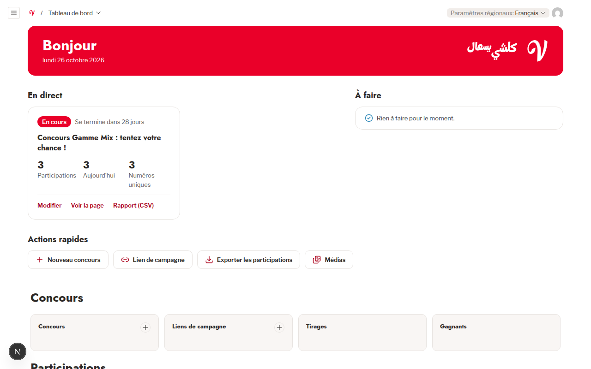

# 3. Navigation & Interface Overview

The Vanidel administrative interface is structured to give campaign managers instantaneous access to live metrics, actionable tasks, and core collections.

---

## 3.1 The Main Dashboard (_Tableau de bord_)

Upon signing in, you land on the primary operational dashboard:


_Figure 3.1: The Vanidel operational dashboard for commercial staff._

The dashboard is divided into three key functional zones:

### 1. Zone "En direct" (_Live Contests_)

This area highlights all currently active or upcoming campaigns:

- **Status Indicator**: Displays whether the contest is currently open (_En cours_), scheduled (_À venir_), or closed (_Terminé_).
- **Time Remaining**: Displays an automatic countdown to the close date (e.g. _"Se termine dans 28 jours"_).
- **Key Real-Time Metrics**:
  - **Participations**: Total number of submissions recorded so far.
  - **Aujourd’hui**: Entries submitted since midnight (Algiers time, 00:00).
  - **Numéros uniques**: Distinct Algerian mobile numbers that have participated.
- **Quick Links**:
  - **Modifier**: Directly opens the contest configuration and tabs.
  - **Voir la page**: Opens the public contest landing page in a new browser tab.
  - **Rapport (CSV)**: Instantly downloads the up-to-date campaign analytics spreadsheet.

### 2. Zone "Actions rapides" (_Quick Actions_)

One-click shortcuts to high-frequency operational tasks:

- **Nouveau concours**: Starts a new campaign draft.
- **Lien de campagne**: Generates a new marketing tracking link and QR code.
- **Exporter les participations**: Opens the participations collection for immediate CSV download.
- **Médias**: Opens the centralized visual asset gallery.

### 3. Collection Directory Cards

Below the summary widgets, full list overviews are organized by operational domain:

- **Concours**: Contests, Campaign Links, Draws, Winners.
- **Participations**: Participations, Contacts, Consent Records.
- **Contenu**: Media library.
- **Administration**: Settings (and Users if authorized).

---

## 3.2 The Administrative Sidebar

The persistent left navigation sidebar organizes all platform features:

```text
┌────────────────────────────────────────┐
│  Vanidel Admin Navigation              │
├────────────────────────────────────────┤
│  ↗ Voir le site                        │
├────────────────────────────────────────┤
│  ▼ CONCOURS                            │
│    • Concours                          │
│    • Liens de campagne                 │
│    • Tirages                           │
│    • Gagnants                          │
├────────────────────────────────────────┤
│  ▼ PARTICIPATIONS                      │
│    • Participations                    │
│    • Contacts                          │
│    • Consentements                     │
├────────────────────────────────────────┤
│  ▼ CONTENU                             │
│    • Médias                            │
├────────────────────────────────────────┤
│  ▼ ADMINISTRATION                      │
│    • Utilisateurs (Admin only)         │
│    • Paramètres                        │
├────────────────────────────────────────┤
│  ⎋ Se déconnecter                      │
└────────────────────────────────────────┘
```

> [!NOTE]
> On mobile and tablet screens, the navigation sidebar collapses into a hamburger menu button (**Ouvrir Menu**), preserving maximum screen space for auditing tables and reviewing receipt images.

---

## 3.3 List Views, Search & Filtering Capabilities

Every collection list view includes powerful tools for navigating large volumes of data:

1. **Global Search Input**: Real-time filtering by keyword, participant name, telephone number, or contest title.
2. **Column Selector (**Colonnes**)**: Customize which fields appear in your table view.
3. **Filter Builder (**Filtres**)**: Construct precise compound queries (e.g. `Wilaya equals 16` AND `Canal equals facebook`).
4. **Sortable Columns**: Click any column header to sort ascending or descending.
5. **Pagination**: Switch between 10, 25, 50, or 100 rows per page with clear total count indicators (e.g., _"1-3 de 3"_).
