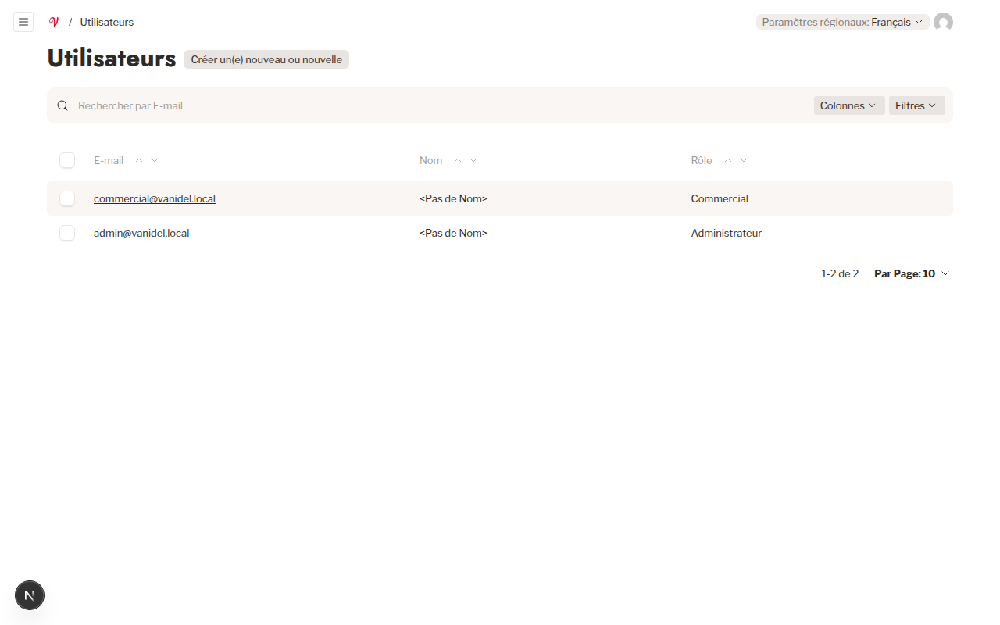

# 6. Roles & Permissions

The Vanidel platform enforces strict role-based access control (RBAC) across its public and administrative interfaces.

---

## 6.1 Role Definitions

### 1. Participant (Public Visitor)

- Anonymous Algerian consumer browsing the public website.
- Requires no credentials or authentication.
- Can view active campaigns, read rules, inspect prizes, submit an entry, upload a receipt, view masked winners, and browse past archives.
- **Restrictions**: Cannot view backend data, read unmasked names, access raw ticket photos of other participants, or execute administrative actions.

### 2. Commercial Team (`commercial`)

- Vanidel operational staff member responsible for day-to-day campaign execution.
- Can create, duplicate, edit, preview, schedule, and publish contests.
- Can generate campaign links and download print-ready QR codes.
- Can browse participations and review receipt photos to verify winners.
- Can trigger weekly draws and execute replacement re-draws.
- Can publish or unpublish winners.
- Can download campaign analytics reports and export marketing contacts.
- **Restrictions**:
  - Cannot delete contests, media, or participations.
  - Cannot access the `Users` collection or create staff accounts.
  - Cannot modify server infrastructure or security settings.

### 3. Administrator (`admin`)

- System administrator or lead technical operator.
- Holds complete supervisory control over the platform.
- Inherits all Commercial team capabilities.
- Can manage staff user accounts and assign roles (`commercial` or `admin`).
- Can delete disposable contest drafts or obsolete media files.
- Can configure global settings (Meta Pixel, Google Analytics ID, social URLs, data retention days, legal rich text).

---

## 6.2 Permission Matrix

| Capability / Resource                          | Public Participant | Commercial Team |  Administrator  |
| :--------------------------------------------- | :----------------: | :-------------: | :-------------: |
| **Browse active contests & prizes**            |         ✓          |        ✓        |        ✓        |
| **Submit participation & upload receipt**      |         ✓          |        ✓        |        ✓        |
| **View masked published winners**              |         ✓          |        ✓        |        ✓        |
| **View past contest archives**                 |         ✓          |        ✓        |        ✓        |
| **Access Admin Dashboard (`/admin`)**          |         ✗          |        ✓        |        ✓        |
| **Create & duplicate contests**                |         ✗          |        ✓        |        ✓        |
| **Edit contest content, steps, & prizes**      |         ✗          |        ✓        |        ✓        |
| **Preview draft contests via token**           |         ✗          |        ✓        |        ✓        |
| **Publish or close contests**                  |         ✗          |        ✓        |        ✓        |
| **Delete contests**                            |         ✗          |        ✗        |        ✓        |
| **Create campaign links & export QR codes**    |         ✗          |        ✓        |        ✓        |
| **View participations audit table**            |         ✗          |        ✓        |        ✓        |
| **Inspect unmasked participant details**       |         ✗          |        ✓        |        ✓        |
| **View & download receipt photos**             |         ✗          |        ✓        |        ✓        |
| **Modify or delete participations**            |         ✗          |        ✗        | ✗ _(Immutable)_ |
| **Trigger operator draws**                     |         ✗          |        ✓        |        ✓        |
| **Void winners & execute re-draws**            |         ✗          |        ✓        |        ✓        |
| **Publish / unpublish winners**                |         ✗          |        ✓        |        ✓        |
| **Download contest analytics CSV**             |         ✗          |        ✓        |        ✓        |
| **Export marketing contacts CSV**              |         ✗          |        ✓        |        ✓        |
| **Upload & manage media library**              |         ✗          |        ✓        |        ✓        |
| **Delete media files**                         |         ✗          |        ✗        |        ✓        |
| **View Users collection**                      |         ✗          |        ✗        |        ✓        |
| **Create & manage staff accounts**             |         ✗          |        ✗        |        ✓        |
| **Configure Global Tracking & Legal Settings** |         ✗          |    Read-only    |        ✓        |

---

## 6.3 Admin vs Commercial Visual Comparison

In the admin navigation sidebar:

- For **Commercial** staff, the `Administration` section displays only **Paramètres** (`/admin/globals/settings`).
- For **Administrators**, the `Administration` section displays both **Utilisateurs** (`/admin/collections/users`) and **Paramètres**:

_Figure 6.1: The Users collection visible exclusively to administrators._
